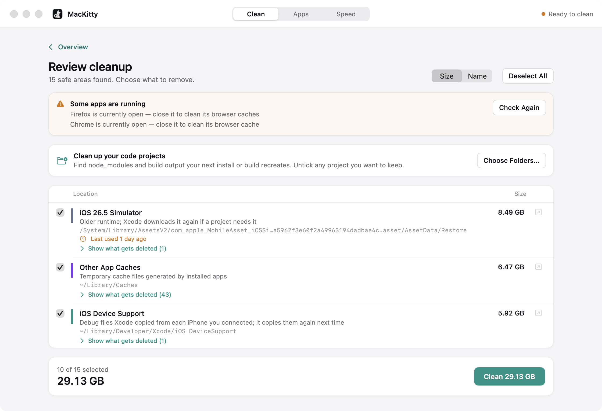
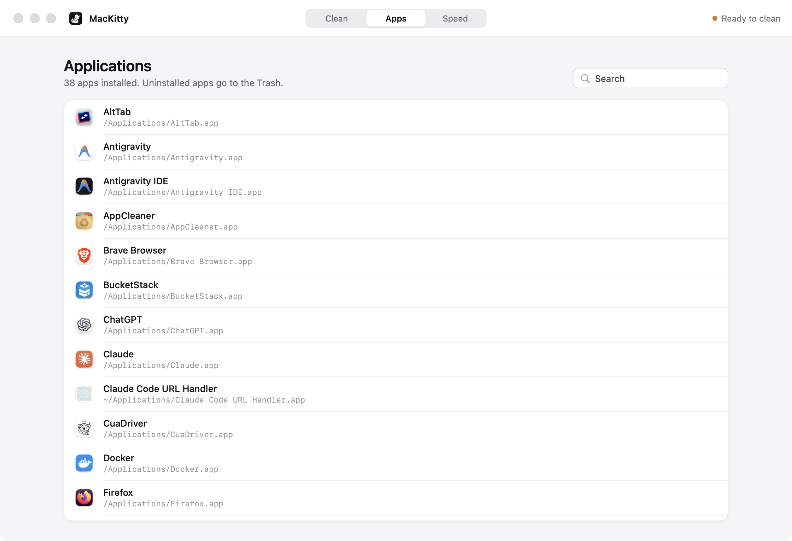
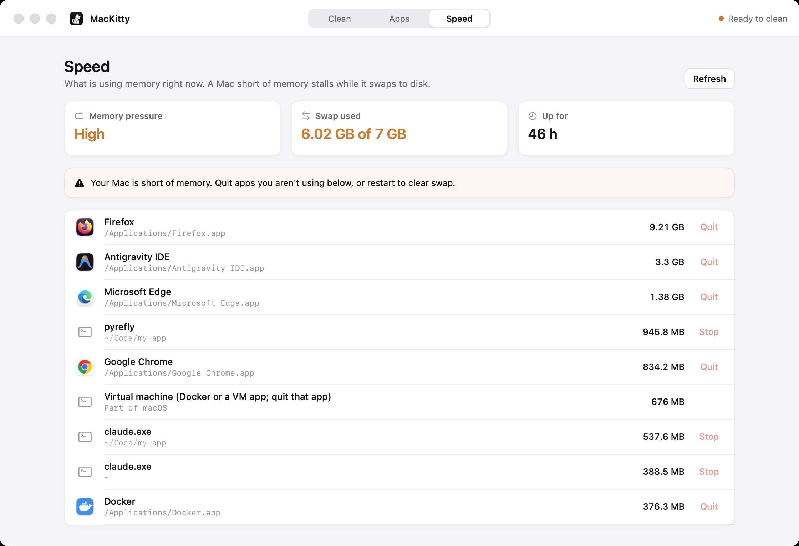

# MacKitty 🐱
> A calmer, cleaner, faster Mac. Zero bloat, zero telemetry.

MacKitty is a free, native Swift cleaner for macOS. It frees space from developer and app caches, `node_modules` and build output, Python virtual environments, old simulators and Android emulators, Docker and the Trash, and lists every file and folder before it deletes anything. The Speed tab shows what is slowing your Mac down, and uninstalling an app removes its leftovers too. It idles at about 2% CPU and 40 MB of memory.

<p align="center">
  <br>
  <em>Scan results: tick what to remove and open “Show what gets deleted” to see every file and folder first.</em>
</p>

<p align="center">
  <br>
  <em>Apps: search installed apps and uninstall them together with their leftovers.</em>
</p>

<p align="center">
  <br>
  <em>Speed: memory pressure, swap and the apps and tools using the most memory, each with Quit or Stop.</em>
</p>

---

## 🛡️ Safety Guarantees: Zero Mac-Breaking Deletions

MacKitty is architected around **strict non-destructive safety principles**:

| Safety Feature | How MacKitty Protects Your Mac |
| :--- | :--- |
| **Dry-Run Preview First** | Scanning only measures folders. **Zero files are removed** during a scan. |
| **Review & Confirm** | Nothing is deleted automatically. Every row shows what it is, its path and size, and a list of exactly which files and folders Clean will remove; untick anything you want to keep and confirm before anything is removed. |
| **Curated Safe Paths Only** | Cleanup is restricted to regenerable user caches (`~/Library/Caches`), developer artifacts (Xcode `DerivedData`, package-manager caches, and build output inside the code folders you choose) and logs (`~/Library/Logs`). Apple's own caches (`com.apple.*`, e.g. iCloud) and caches of apps that are currently running are always skipped. MacKitty **never touches `/System` or personal directories (Documents, Desktop, Downloads, Photos, iCloud)**, and only removes an app from `/Applications` when you uninstall it. |
| **Active App Lock Protection** | Automatically detects when browsers (Firefox, Chrome, Safari, Brave) or developer tools (Xcode) are open, warning you rather than attempting to purge locked databases or causing app crashes. |
| **Standard User Privileges** | MacKitty runs with your normal user permissions, installs no background daemons and loads no kernel extensions. It asks for your admin password only when you uninstall an app that left a launch daemon or privileged helper in `/Library`, using the standard macOS prompt. |
| **Instant Cancellation** | Scans and cleanups can be cancelled at any moment; a cancelled run can never resume or apply stale results. |
| **Verified Updates** | The updater only installs a build that is signed by MacKitty's Developer ID team, has the MacKitty bundle ID, passes Gatekeeper (notarized) and was downloaded from GitHub over HTTPS. |

---

## ✨ Features

- **One-Screen Dashboard:** Storage donut (used / reclaimable / free), live CPU and memory charts, battery and network status, a per-cleanup bar chart and lifetime totals — no scrolling.
- **Guided Scan & Clean:** Progress with live file counts and paths, then a sortable review table and a confirmation before anything is removed.
- **Menu Bar Popover:** Click the cat icon for storage, live vitals and a one-click Scan.
- **Safe Cleanup Areas:**
  - Xcode Derived Data
  - Safari, Chrome and Firefox caches
  - npm & Node cache
  - Developer caches: Gradle, uv, Bun, pnpm and Cargo (shown only when installed; skipped while a build or tool is using them)
  - Old Simulator runtimes (the newest per platform is kept; Xcode downloads an old one again if needed) and simulators whose runtime is gone
  - iOS Device Support (debug files Xcode copies from each connected iPhone) and the Expo cache (your Expo login and signing files stay)
  - Android emulators, one row each, unticked (they hold the apps installed in them)
  - Trash, unticked (needs Full Disk Access)
  - User app logs
  - Other app caches (excluding Apple and running apps)
  - Docker images no container uses and unused build cache (when Docker is running)
- **Code Project Cleanup:** Choose your code folders and MacKitty lists each project's `node_modules`, Rust `target`, Gradle/Flutter/Swift build output, CocoaPods `Pods` and framework caches (`.next`, `.turbo`…), `dist`/`out` next to `package.json`, Python `.venv` (next to `pyproject.toml`/`requirements.txt`), `__pycache__` and pytest/mypy/ruff caches, and Playwright output (`test-results`, `.playwright-mcp`). Each folder is recognised by the file that produces it (e.g. `build/` only next to `build.gradle`). Git-tracked folders are never offered. Every project starts ticked; notes flag projects you worked on this week, that are open in a running dev server or that contain a shipped build (`.apk`, `.aab`, `.ipa`), so you can untick them.
- **Apps Manager:** Search installed applications, reveal them in Finder, or uninstall them. Uninstall also lists what the app left behind (its data, caches, preferences and background helpers, matched by bundle ID) so you can remove those too; helpers in `/Library` ask for your admin password.
- **Speed:** Memory pressure, swap and uptime, plus the apps and dev servers using the most memory, each with Quit or Stop. Read only when you open the tab; nothing polls.
- **Verified Auto-Updater:** Checks GitHub Releases and installs signed, notarized updates in place.
- **100% Private:** No accounts, no data collection, no telemetry, no analytics.

---

## 🚀 Getting Started

### Prerequisites
- macOS 14.0 (Sonoma) or newer
- Xcode 15+ or Swift 5.10+ command line tools

### Build & Run
Clone the repository and launch the app using the bundled build script:

```bash
# Build and launch MacKitty
./script/build_and_run.sh run

# Verify compilation and process startup
./script/build_and_run.sh --verify
```

### Project Layout
- `Sources/MacKitty/Views/` — SwiftUI screens (`SimpleDashboardView.swift` is the main window, `TrayMiniDashboardView.swift` the menu bar popover)
- `Sources/MacKitty/Support/Theme.swift` — design tokens (colours, type, card and button styles)
- `Sources/MacKitty/Services/` — native cleaner, system monitor, updater
- `website/` — marketing site with an interactive demo of the app (after editing `website/styles.css` or `website/app.js`, run `./script/stamp_website_assets.sh` so browsers don't reuse a cached copy)
- `AppStore/`, `script/build_appstore.sh`, `docs/app-store-submission.md` — sandboxed Mac App Store build (on hold)

### Website
`website/` is deployed as-is by Cloudflare Pages (no build step). Besides the page itself it holds:
- `_headers` — security headers, including a Content Security Policy that allows only this site and PilotFox analytics. Add any new third-party origin there.
- `_redirects` and `404.html` — old `/privacy.html` and `/terms.html` URLs redirect to the modals, and unknown URLs get a real 404.
- `robots.txt`, `sitemap.xml`, `llms.txt`, `llms-full.txt` — hand-written crawler files. Update `llms-full.txt` and the sitemap `<lastmod>` when page copy changes.

Check the site before pushing:

```bash
python3 script/check_website.py      # static checks, Python 3 stdlib only
node script/website_smoke_test.js    # serves website/ like Cloudflare Pages and drives the demo in Chromium (needs Playwright)
```

AI coding agents: see `AGENTS.md` (`CLAUDE.md` imports it).

---

## 🌐 Contact & Support

- **Website:** [mackitty.com](https://mackitty.com)
- **Email Support:** [hello@mackitty.com](mailto:hello@mackitty.com)
